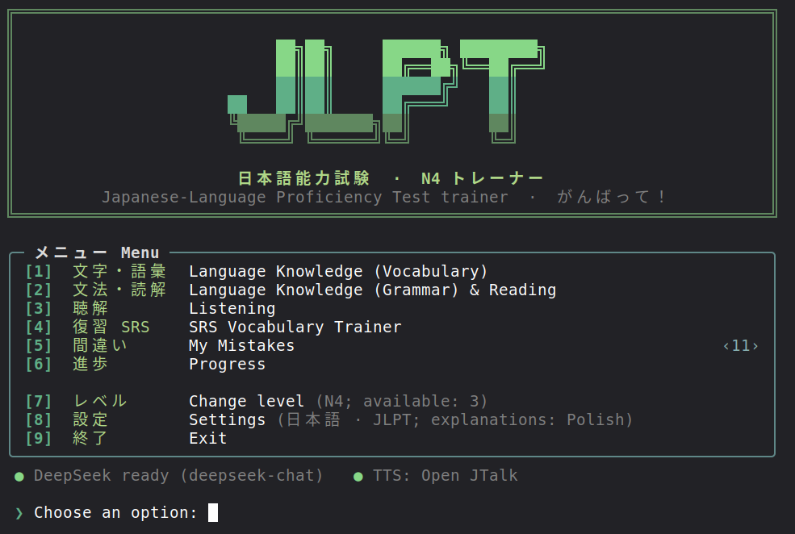
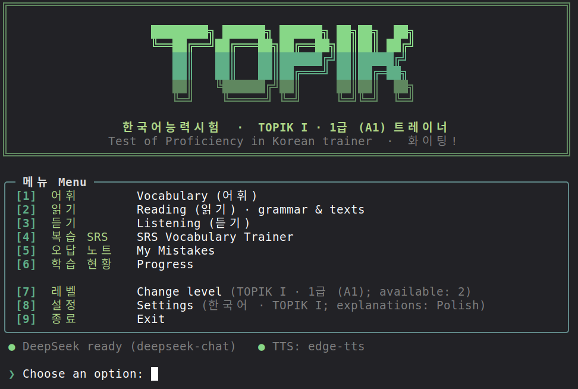
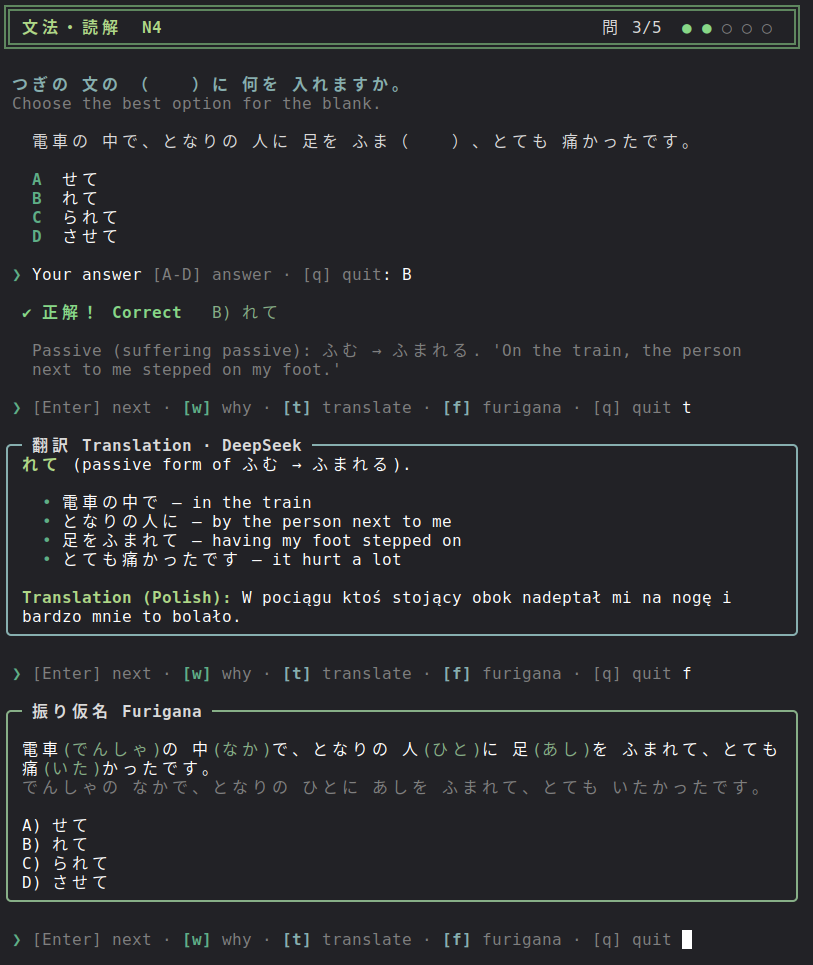
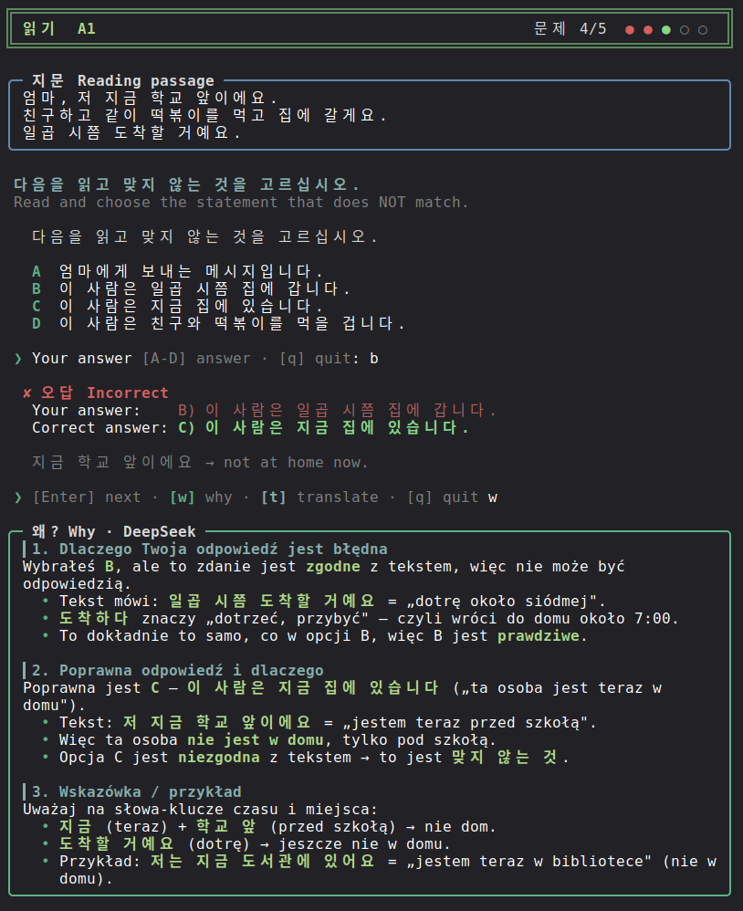
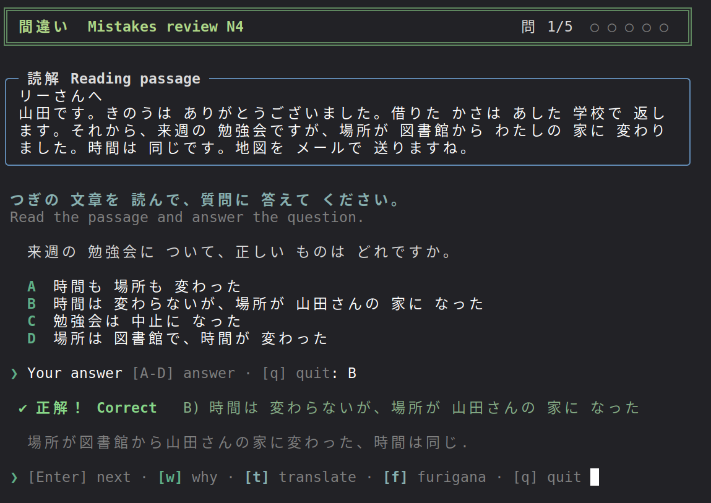
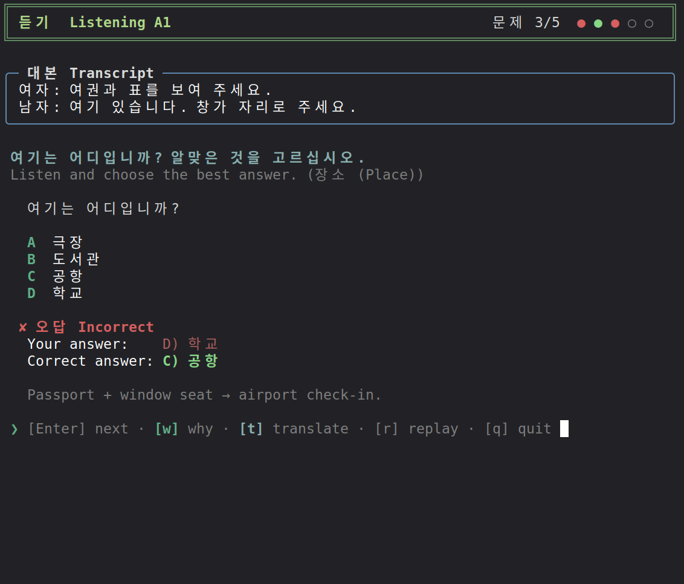

# jp-kor-trainer - JLPT / TOPIK Trainer

A fast, colourful terminal trainer for the **Japanese JLPT (N5–N3)** and the **Korean TOPIK I (A1–A2)** exams.
Exam-style multiple-choice questions, real listening practice with synthesized voices, spaced repetition,
a mistakes notebook and AI explanations - all in your terminal.

<p align="center">
  
  
</p>

## Features

- **Two languages, one app** - switch between Japanese (JLPT) and Korean (TOPIK I) in *Settings*.
- **Exam-format questions** - every closed question type of the real tests: vocabulary, grammar, sentence order (★), reading, paraphrase/usage.
- **Listening** - dialogues are spoken by male/female voices, exactly like the exam parts (課題理解, 概要理解, 即時応答 / 듣기 1–30).
- **Study tools after every answer** - `w` explain why (even when you guessed right), `t` translate, `f` furigana (Japanese).
- **SRS vocabulary trainer**, **My Mistakes** notebook and a **Progress** screen.

| Level | Words | Grammar & reading | Listening |
|---|---|---|---|
| JLPT N5 | 498 | 140 | 100 |
| JLPT N4 | 546 | 175 | 101 |
| JLPT N3 | 547 | 152 | 100 |
| TOPIK I · 1급 (A1) | 589 | 152 | 100 |
| TOPIK I · 2급 (A2) | 554 | 153 | 100 |

## Download

Grab the archive for your system from the [Releases](../../releases) page:

| System | File |
|---|---|
| Linux x86_64 (any distro, static) | `jp-kor-trainer-1.0-linux-x86_64.tar.gz` |
| Linux ARM64 (Raspberry Pi 4/5, …) | `jp-kor-trainer-1.0-linux-arm64.tar.gz` |
| macOS Apple Silicon (M1–M4) | `jp-kor-trainer-1.0-macos-arm64.tar.gz` |
| macOS Intel | `jp-kor-trainer-1.0-macos-x86_64.tar.gz` |
| Windows 10/11 x64 | `jp-kor-trainer-1.0-windows-x86_64.zip` |

## Quick start

**Linux / macOS**

```bash
tar xzf jp-kor-trainer-1.0-<system>.tar.gz
cd jp-kor-trainer-1.0-<system>
./jp-kor-trainer                 # Japanese, N4
./jp-kor-trainer --lang ko       # Korean, TOPIK I A1
./jp-kor-trainer --level N5      # pick a level
```

> **macOS:** the binary is not notarized. If macOS blocks it, run
> `xattr -d com.apple.quarantine jp-kor-trainer` once (or right-click → Open in Finder).

**Windows** — unzip, open **Windows Terminal** in the folder and run:

```powershell
.\jp-kor-trainer.exe
.\jp-kor-trainer.exe --lang ko
```

Use Windows Terminal (default on Windows 11) for colours and Japanese/Korean characters.

That's it — vocabulary, grammar, reading, SRS and progress work out of the box.
No libraries to install. Your progress is saved in `userdata/` next to the binary.

### Optional: voices for listening

| | Japanese | Korean |
|---|---|---|
| **Linux** | `sudo apt install open-jtalk open-jtalk-mecab-naist-jdic hts-voice-nitech-jp-atr503-m001`<br>(or `./scripts/setup_tts.sh` without sudo) | `sudo apt install ffmpeg python3-venv`<br>`./scripts/setup_tts_ko.sh` |
| **macOS** | built in — voice *Kyoko* | built in — voice *Yuna* |
| **Windows** | built in — add *Japanese* under Settings › Time & language › Speech | built in — add *Korean* the same way |

Better voices everywhere (optional): `pip install edge-tts` plus `ffmpeg` on the PATH gives natural
Microsoft neural voices (`brew install ffmpeg` / `winget install ffmpeg`). They need internet the first time
a recording is generated; audio is cached afterwards. On Linux an audio player is needed too
(`pipewire-bin`, `pulseaudio-utils` or `alsa-utils`); macOS and Windows play audio natively.

### Optional: furigana (`f`) — Open JTalk setup

Furigana readings come from [Open JTalk](https://open-jtalk.sourceforge.net/)'s text analysis. The app needs
three things: the `open_jtalk` program, its dictionary (`naist-jdic`, UTF-8) and one `.htsvoice` voice file
(the voice is required even for furigana). Open JTalk also becomes the Japanese listening voice once it is set up.

The paths go into the `tts` block of `settings.json` (next to the binary). An empty value means "auto-detect":

```json
"tts": {
  "open_jtalk_bin": "",
  "dictionary": "",
  "voice_male": "",
  "voice_female": "",
  ...
}
```

#### Linux

1. Install the packages (Debian / Ubuntu / Mint / Raspberry Pi OS):
   ```bash
   sudo apt install open-jtalk open-jtalk-mecab-naist-jdic hts-voice-nitech-jp-atr503-m001
   ```
   No sudo? Run `./scripts/setup_tts.sh` in the app folder instead. It unpacks the same packages into
   `third_party/open_jtalk/`.
2. Leave `settings.json` as it is. The app finds `/usr/bin/open_jtalk`,
   `/var/lib/mecab/dic/open-jtalk/naist-jdic` and the nitech voice (or `third_party/open_jtalk/`) on its own.
3. Other distros: install Open JTalk with your package manager (e.g. `open-jtalk` from the AUR) or build it as in
   the Windows steps below. Then fill in `dictionary` and `voice_male` with the paths it installed.

#### macOS

1. Install [Homebrew](https://brew.sh) if you don't have it, then:
   ```bash
   brew install open-jtalk
   ```
2. Print the paths you need:
   ```bash
   echo "$(brew --prefix open-jtalk)/dic"
   echo "$(brew --prefix open-jtalk)/voice/m100/nitech_jp_atr503_m001.htsvoice"
   echo "$(brew --prefix open-jtalk)/voice/mei/mei_normal.htsvoice"
   ```
3. Put them in `settings.json`. `open_jtalk` is on the PATH, so `open_jtalk_bin` can stay empty. On Apple Silicon
   it looks like this (Intel Macs use `/usr/local` instead of `/opt/homebrew`):
   ```json
   "dictionary":   "/opt/homebrew/opt/open-jtalk/dic",
   "voice_male":   "/opt/homebrew/opt/open-jtalk/voice/m100/nitech_jp_atr503_m001.htsvoice",
   "voice_female": "/opt/homebrew/opt/open-jtalk/voice/mei/mei_normal.htsvoice",
   ```

Open JTalk now replaces *Kyoko* as the listening voice. Kyoko is still used as a fallback.

#### Windows

There is no official Windows build of Open JTalk, so you compile it once with MSYS2. This takes about 10 minutes.

1. Install [MSYS2](https://www.msys2.org) and open the **MSYS2 UCRT64** shell from the Start menu.
   Use UCRT64, not the plain "MSYS2 MSYS" shell.
2. Install the compiler and tools:
   ```bash
   pacman -S --needed base-devel mingw-w64-ucrt-x86_64-gcc
   ```
3. Download the sources, the voice and the UTF-8 dictionary:
   ```bash
   mkdir -p ~/ojt && cd ~/ojt
   SF=https://downloads.sourceforge.net
   curl -LO $SF/hts-engine/hts_engine_API-1.10.tar.gz
   curl -LO $SF/open-jtalk/open_jtalk-1.11.tar.gz
   curl -LO $SF/open-jtalk/open_jtalk_dic_utf_8-1.11.tar.gz
   curl -LO $SF/open-jtalk/hts_voice_nitech_jp_atr503_m001-1.05.tar.gz
   for f in *.tar.gz; do tar xzf "$f"; done
   ```
4. Build the HTS engine, then Open JTalk, into `C:\open_jtalk`. `-static` makes the `.exe` work outside MSYS2.
   The older C/C++ standard flags let the 2015-era code compile with a current GCC.
   ```bash
   export CFLAGS="-O2 -fpermissive" CXXFLAGS="-O2 -std=gnu++14" LDFLAGS="-static"
   HOST=x86_64-w64-mingw32

   cd ~/ojt/hts_engine_API-1.10
   ./configure --host=$HOST --prefix=/c/open_jtalk && make && make install

   cd ~/ojt/open_jtalk-1.11
   ./configure --host=$HOST --prefix=/c/open_jtalk --with-charset=UTF-8 \
     --with-hts-engine-header-path=/c/open_jtalk/include \
     --with-hts-engine-library-path=/c/open_jtalk/lib
   make && make install
   ```
5. Copy the dictionary and the voice next to it:
   ```bash
   cp -r ~/ojt/open_jtalk_dic_utf_8-1.11 /c/open_jtalk/dic
   mkdir -p /c/open_jtalk/voice
   cp ~/ojt/hts_voice_nitech_jp_atr503_m001-1.05/nitech_jp_atr503_m001.htsvoice /c/open_jtalk/voice/
   ```
6. Put the paths in `settings.json`. Use forward slashes, or write every backslash twice (`C:\\open_jtalk\\...`):
   ```json
   "open_jtalk_bin": "C:/open_jtalk/bin/open_jtalk.exe",
   "dictionary":     "C:/open_jtalk/dic",
   "voice_male":     "C:/open_jtalk/voice/nitech_jp_atr503_m001.htsvoice",
   ```

You can delete MSYS2 and `~/ojt` afterwards, because `C:\open_jtalk` is self-contained.
Alternatively, run the Linux release inside [WSL](https://learn.microsoft.com/windows/wsl/install) and follow the
Linux steps there.

#### Check that it works

Test Open JTalk on its own first. This should create `out.wav` without errors (on Windows, run it in the UCRT64
shell with your `C:/open_jtalk/...` paths):

```bash
echo "日本語を勉強しています" > test.txt
open_jtalk -x <dictionary> -m <voice_male> -ow out.wav test.txt
```

Then start the app. The main menu should show `TTS: Open JTalk`. Answer a question and press `f`: kanji get their
readings in green, e.g. `日本語(にほんご)を勉強(べんきょう)しています`. If the app shows *"Furigana needs Open JTalk: …"*,
the rest of that message says which of the three parts it could not find.

### Optional: AI explanations (`w`) and translations (`t`)

Uses the [DeepSeek API](https://platform.deepseek.com). Provide a key in one of two ways:

```bash
export DEEPSEEK_API_KEY=sk-...                          # environment variable
# or
mkdir -p ~/.config/jp-kor-trainer && echo 'sk-...' > ~/.config/jp-kor-trainer/deepseek.key
```

On Windows `~` is your user folder (`%USERPROFILE%`). `curl` is built into Windows 10/11 and macOS.

Or point the app to any key file in *Settings → 3 DeepSeek API key file*.
The explanation language (Polish, English, Japanese, Korean, …) is chosen in *Settings* too.

## How it looks

<p align="center">
  
  
</p>
<p align="center">
  
  
</p>

## Controls

| Where | Keys |
|---|---|
| Main menu | `1`–`6` modules · `7` level · `8` settings · `9` exit |
| Question | `A`–`D` (or `1`–`4`) answer · `r` replay audio · `q` quit |
| After answering | `Enter` next · `w` why · `t` translate · `f` furigana · `q` quit |
| SRS | `h` / `g` / `e` hard · good · easy |

## Configuration

`settings.json` (next to the binary): default language and levels, session size, SRS limits,
DeepSeek key file and explanation language, voice options (`tts`, `tts_ko`).
Environment: `DEEPSEEK_API_KEY`, `JP_KOR_TRAINER_HOME` (data root), `NO_COLOR`.

## Build from source

```bash
sudo apt install build-essential cmake
cmake -S . -B build && cmake --build build -j
./build/jp-kor-trainer

./scripts/make_release.sh      # release archives for all systems → release/ (cross-compiles with Zig)
```

Question banks live in `data/<ja|ko>/levels/<LEVEL>/` as plain JSON - add a level by adding a folder.
All questions, texts and dialogues are original, written for this app in the official exam formats.
